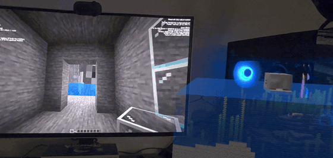
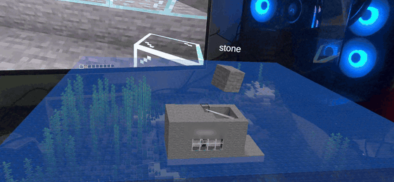
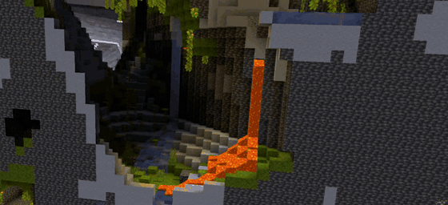
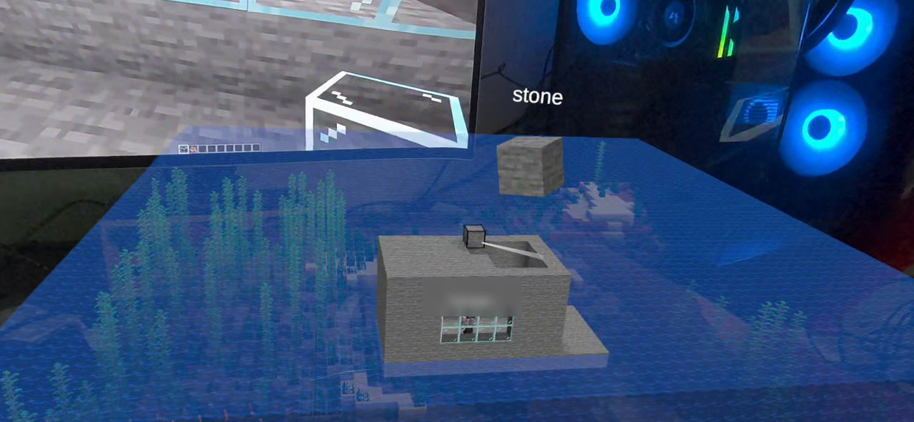
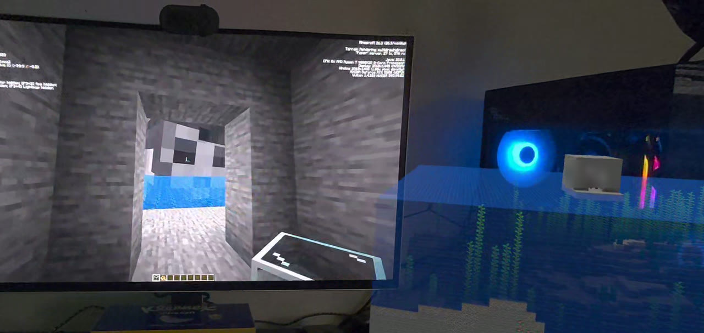
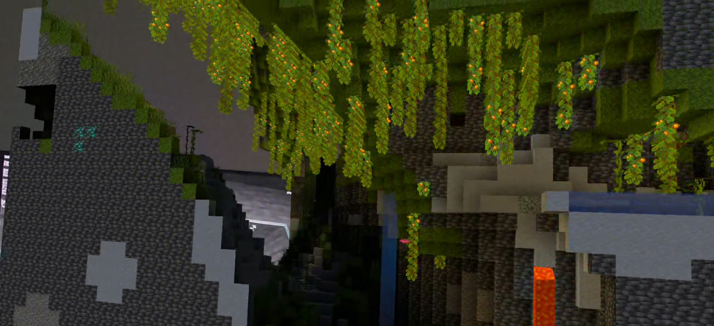

# tabletop-craft-ar

[](https://ko-fi.com/nickstassen)

A live block world from a **Minecraft: Java Edition** server, shown as a miniature on a real table in **Meta Quest 3** passthrough AR. Java players walk around inside it in real time, and they see the headset user as a giant whose head and hands follow the headset and controllers.

> Not an official Minecraft product. Not approved by or associated with Mojang or Microsoft. This project ships no Mojang assets: textures come from a resource pack you supply.



*On the monitor, a Java player in their hut sees the headset user as a giant head (wearing their skin) peering in through the doorway. Next to it is the same world as a live miniature on the desk, seen through the Quest 3.*

Related: the idea write-up [VR-7 in NickStassen/ideas](https://github.com/NickStassen/ideas/blob/master/vr/07-minecraft-ar-tabletop.md) and the sister project [ironman-quest3-hud](https://github.com/NickStassen/ironman-quest3-hud), which has the Unity 6000.0.84f1 + Meta XR setup this project reuses.

## How it works

```
Java players (LAN) ──game protocol──▶ Paper 26.3 + tabletop plugin ◀──JSON over WebSocket (ws://host:8765/tabletop)─────▶ Quest 3 app
                                        │ chunk_snapshot / block_update / player_positions ──────────────────────▶ │ greedy-meshed miniature on the table
                                        │ ◀────────────────────────────────────────── pose (head + hands, 30 Hz)    │
                                        └ giant avatar: floating player-head + 2 hand ItemDisplays (or a Mannequin)
```

- **server-plugin/**: Paper plugin (Java 25, Gradle Kotlin DSL, Java-WebSocket 1.6.0 shaded). Streams a configurable box (default 32x64x32) and drives the giant.
- **quest-app/**: Unity 6000.0.84f1 project skeleton + C# scripts (link client, protocol, greedy mesher, resource-pack atlas, MRUK table placement, pose sender, player markers). Runs on a Quest 3 (first session 2026-10-13) and builds headless on Linux. See [docs/QUEST_SETUP.md](docs/QUEST_SETUP.md).
- **tools/**: Python fake-Quest client, protocol fixtures, the mineflayer second-player bot, and `e2e.sh`, which runs the whole server-side stack headless.
- **docs/**: [ARCHITECTURE](docs/ARCHITECTURE.md), [PROTOCOL](docs/PROTOCOL.md) (normative wire format, v1), [PLAN](docs/PLAN.md), [RESEARCH](docs/RESEARCH.md), [TESTING](docs/TESTING.md), [QUEST_SETUP](docs/QUEST_SETUP.md).

## Status

| Part | State |
|---|---|
| Plugin: snapshot, block updates, players, subscribe, errors, timeouts | Tested end to end on a headless Paper 26.3 server (and earlier on 1.21.11); see [TESTING](docs/TESTING.md) |
| Giant avatar following poses | Floating head + hands (default): positions and head rotation match the poses exactly on a 26.3 test server, and a mineflayer player receives the three displays (TESTING section 7); not yet seen by eye. Mannequin modes: on the first headset session a Java client on an online-mode server saw the giant follow the headset wearing the user's skin (exact placement); ground placement was tried and replaced as the default |
| Java players on the table (skinned, animated figures) | Geometry, UVs, animation and skin rules unit-tested; skin download checked in the Unity Editor; not yet seen on a headset |
| Quest C# protocol/mesher code | Compiled and unit-tested with .NET 8 outside Unity, plus a live session against the plugin |
| Block editing from the headset (break, place, pick) | Plugin side and the Quest's targeting/edit code tested live against Paper 26.3 (unit tests, `Tests~ --live-edit`, `tools/edit_check.py`); not yet tried on a headset. See [TESTING](docs/TESTING.md) "Block editing" and [QUEST_SETUP](docs/QUEST_SETUP.md) Part I |
| Quest app in Unity | Compiles and builds an APK on Linux, headless (Unity 6000.0.84f1, Meta XR 85.0.0); see [TESTING](docs/TESTING.md) section 5 |
| Quest app on a headset | First session on a Quest 3: passthrough, Wi-Fi link to Paper 26.3 (RTT 13-42 ms), a 64x96x64 area textured from the 26.3 client jar at a steady 72 FPS (~2.5 ms app GPU), the Java player on the table, and the giant (with the user's skin) seen from a Java client. MRUK table detection, area setup and the newer rendering work are still to be checked; see [TESTING](docs/TESTING.md) "First headset session" |

## Screenshots

Recorded on the headset. Building from the headset: aim with the right controller, and the triggers place and break blocks. The selected block (stone) floats above the controller, and a laser shows where it will go.



Gliding into the terrain: a lush cave with glow berries and a lava fall. It's lit with Minecraft-style smooth lighting and biome colours, and the textures come from the user's own client jar.



| | | |
|---|---|---|
|  |  |  |

The player name labels in these recordings are blurred, and the shots are cropped so that no screens show anything personal.

## Quick start (server)

Requires JDK 25 (Paper 26.x needs Java 25; the Gradle 9.8.0 wrapper runs on it).

```bash
cd server-plugin && ./gradlew build          # -> build/libs/tabletop-craft-ar-plugin-0.1.0.jar
```

Copy the jar into a Paper **26.3** server's `plugins/`, start the server once, then edit `plugins/TabletopCraftAR/config.yml` (region origin and size, port, optional token). A new 26.x server has `white-list=true` in `server.properties`, so Java players are rejected until you `whitelist add <name>` or set `white-list=false`. In game or in the console:

```
/tabletop status
/tabletop setorigin [x y z]        # region min corner (your position if omitted)
/tabletop setsize <dx> <dy> <dz>   # max 64 x 384 x 64
/tabletop avatar status|spawn|remove|blocksize <m>
/tabletop avatar placement floating|ground|exact   # head + hands at the headset/controllers (default), or a Mannequin
/tabletop avatar skin <java name>         # giant's skin (also tabletop.json skin_player / config avatar.skin-player)
/tabletop reload
```

Fake headset: `pip install -r tools/requirements.txt && python tools/fake_quest.py --url ws://SERVER:8765/tabletop --avatar -v`.

## Legal

Follow the [Minecraft EULA](https://www.minecraft.net/eula) and [usage guidelines](https://www.minecraft.net/usage-guidelines). Running a server means accepting the EULA yourself (`eula.txt`); this repo never commits `eula.txt`, the server jar, or game assets. The Quest app loads textures only from a resource pack or client jar the user already owns.

## License

MIT, see [LICENSE](LICENSE).
