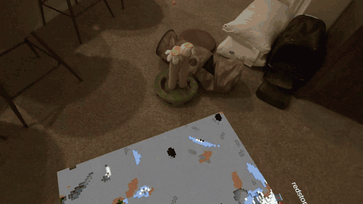
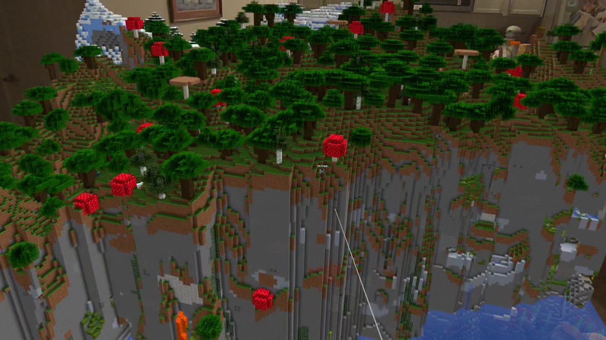
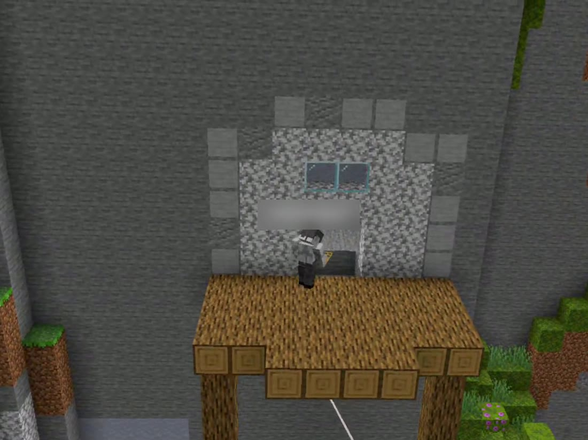
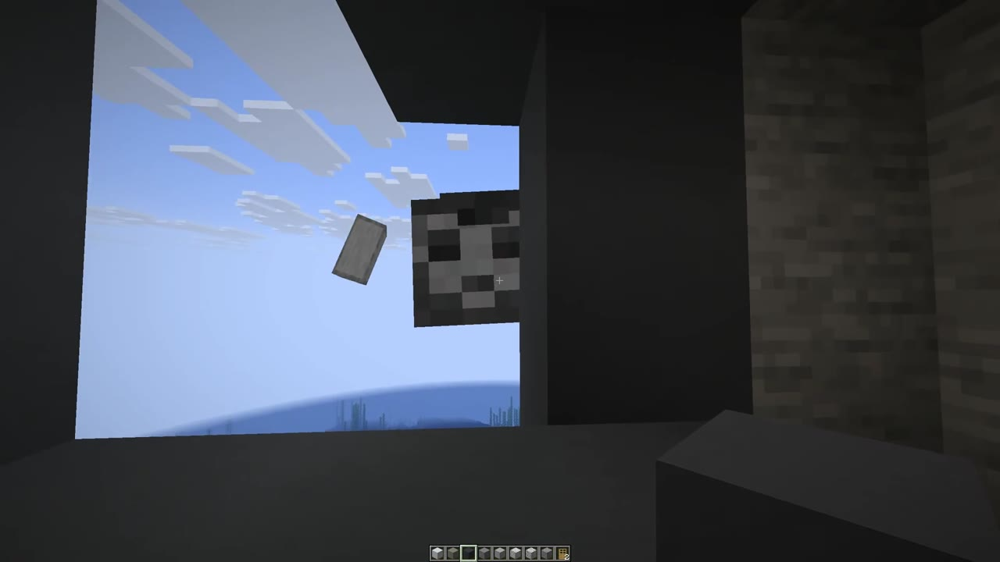
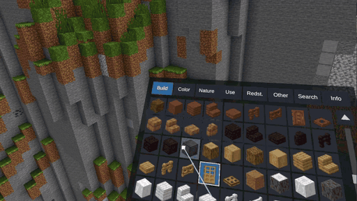
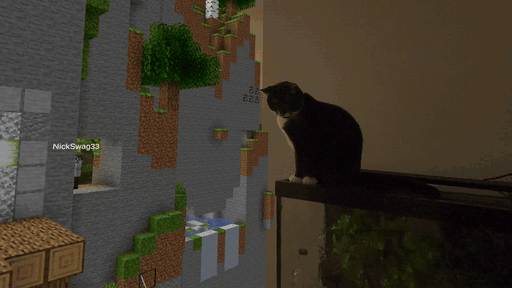
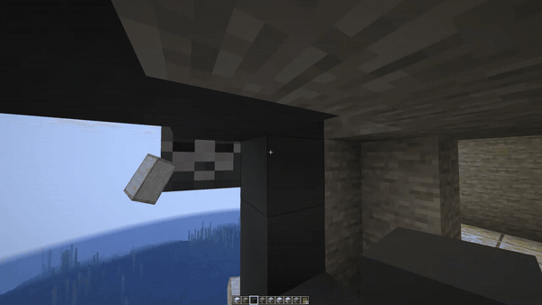

# tabletop-craft-ar

[](https://ko-fi.com/nickstassen)

A live block world from a **Minecraft: Java Edition** server, shown as a miniature on a real table in **Meta Quest 3** passthrough AR. Java players walk around inside it in real time, and they see the headset user as a giant whose head and hands follow the headset and controllers.

> Not an official Minecraft product. Not approved by or associated with Mojang or Microsoft. This project ships no Mojang assets: textures come from a resource pack you supply.



*Grabbing, turning and scaling the miniature from the headset (Quest 3 passthrough). The world shrinks to a block on the floor, is turned, then scaled back up until you are standing in the terrain. A short pause in the middle is cut. Below: building from the block menu, and a Java player seen from the headset, plus the other direction.*

Related: the idea write-up [VR-7 in NickStassen/ideas](https://github.com/NickStassen/ideas/blob/master/vr/07-minecraft-ar-tabletop.md) and the sister project [ironman-quest3-hud](https://github.com/NickStassen/ironman-quest3-hud), which has the Unity 6000.0.84f1 + Meta XR setup this project reuses.

## How it works

```
Java players (LAN) ──game protocol──▶ Paper 26.3 + tabletop plugin ◀──JSON over WebSocket (ws://host:8765/tabletop)─────▶ Quest 3 app
                                        │ chunk_snapshot / block_update / player_positions ──────────────────────▶ │ greedy-meshed miniature on the table
                                        │ ◀────────────────────────────────────────── pose (head + hands, 30 Hz)    │
                                        └ giant avatar: floating player-head + 2 hand ItemDisplays (or a Mannequin)
```

- **server-plugin/**: Paper plugin (Java 25, Gradle Kotlin DSL, Java-WebSocket 1.6.0 shaded). Streams a configurable box (default 32x64x32) and drives the giant.
- **quest-app/**: Unity 6000.0.84f1 project skeleton + C# scripts (link client, protocol, greedy mesher, resource-pack atlas, MRUK table placement, pose sender, player markers). Runs on a Quest 3 (first session 2026-10-13) and builds headless on Linux. See [docs/QUEST_SETUP.md](docs/QUEST_SETUP.md).
- **tools/**: Python fake-Quest client, protocol fixtures, the mineflayer second-player bot, and `e2e.sh`, which runs the whole server-side stack headless.
- **docs/**: [ARCHITECTURE](docs/ARCHITECTURE.md), [PROTOCOL](docs/PROTOCOL.md) (normative wire format, v1), [PLAN](docs/PLAN.md), [RESEARCH](docs/RESEARCH.md), [TESTING](docs/TESTING.md), [QUEST_SETUP](docs/QUEST_SETUP.md).

## Status

| Part | State |
|---|---|
| Plugin: snapshot, block updates, players, subscribe, errors, timeouts | Tested end to end on a headless Paper 26.3 server (and earlier on 1.21.11); see [TESTING](docs/TESTING.md) |
| Giant avatar following poses | Floating head + hands (default): positions and head rotation match the poses exactly on a 26.3 test server, and a mineflayer player receives the three displays (TESTING section 7); not yet seen by eye. Mannequin modes: on the first headset session a Java client on an online-mode server saw the giant follow the headset wearing the user's skin (exact placement); ground placement was tried and replaced as the default |
| Java players on the table (skinned, animated figures) | Working on a Quest 3 headset: a Java player's figure shows up on the miniature (see the "Both sides of the same world" clip below). Geometry, UVs, animation and skin rules are unit-tested, and skin download was checked in the Unity Editor |
| Quest C# protocol/mesher code | Compiled and unit-tested with .NET 8 outside Unity, plus a live session against the plugin |
| Block editing from the headset (break, place, pick) | Verified on a Quest 3 (the screenshots below), and tested live against Paper 26.3 (unit tests, `Tests~ --live-edit`, `tools/edit_check.py`). See [TESTING](docs/TESTING.md) "Block editing" and [QUEST_SETUP](docs/QUEST_SETUP.md) Part I |
| Quest app in Unity | Compiles and builds an APK on Linux, headless (Unity 6000.0.84f1, Meta XR 85.0.0); see [TESTING](docs/TESTING.md) section 5 |
| Quest app on a headset | First session on a Quest 3: passthrough, Wi-Fi link to Paper 26.3 (RTT 13-42 ms), a 64x96x64 area textured from the 26.3 client jar at a steady 72 FPS (~2.5 ms app GPU), the Java player on the table, and the giant (with the user's skin) seen from a Java client. MRUK table detection works (the desk marked as a Table in Space Setup). Area setup (Y) could not open on the headset before 0.3.1 (a button-mapping bug); see [TESTING](docs/TESTING.md) "First headset session" |
| 0.2.0-0.3.1: block menu, width presets, fixes and polish | The block menu and hotbar, width presets up to 256, vanilla placement rules, two-block items, placement preview, grass/tint/mipmap fixes, remembered settings, headset-off pause, offline badge, LAN discovery. Verified on a Quest 3 (2026-10-14) |
| 0.4.0: fast gliding, chat and commands, block entities | Incremental region reads and lookahead; the operator panel on X (chat, console with completion, players, world, server); chests, signs, banners, heads, books, beacons. Tested off the headset; not yet tried on a headset |
| 0.5.0 / 0.5.1: hands, living world, operator and power tools, faster meshing | Using blocks, items and mobs; day/night, weather, leads, mob gear; follow, bookmarks, worlds, containers, signs; undo, box tools, brushes; meshing 3.5x faster and a surface skirt. Tested off the headset; not yet tried on a headset |
| 0.6.0 / 0.7.0: sound, motion | Spatial sound from your own launcher files, opt-in asset delivery; flowing fluids, ambient particles, lids, bells, explosions, poses. Tested off the headset; not yet tried on a headset |
| Bedrock players (Geyser + Floodgate) | Tested with a Bedrock bot on the 26.3 test server: joins, appears on the table, chats both ways, sees the giant (a Mannequin shown only to Bedrock players) and its speech bubble. Not yet tried with a real Bedrock device; see [TESTING](docs/TESTING.md) "Bedrock players" |

## Screenshots

Recorded on the headset. Building from the headset: aim with the right controller, and the triggers place and break blocks. The selected block (stone) floats above the controller, and a laser shows where it will go.


Gliding into the terrain: a lush cave with glow berries and a lava fall. It's lit with Minecraft-style smooth lighting and biome colours, and the textures come from the user's own client jar.


| | | |
|---|---|---|
|  |  |  |
|  |  | |

### Both sides of the same world

Picking a block from the block menu on the headset (the menu floats by the left hand, and the ray selects the block), then a Java player placing doors in the hut, with the changes showing up live on the miniature:



A Java player on the miniature, seen from the headset: the player's figure stands on the mountain next to a real terrarium, and a cat has come to look at the world.



The other direction: the headset user appears to Java players as a giant head that follows the headset, here floating outside and looking in through a window of the hut.



The player name labels in these recordings are blurred.

## Quick start (server)

Requires JDK 25 (Paper 26.x needs Java 25; the Gradle 9.8.0 wrapper runs on it).

```bash
cd server-plugin && ./gradlew build          # -> build/libs/tabletop-craft-ar-plugin-<VERSION>.jar
```

Copy the jar into a Paper **26.3** server's `plugins/`, start the server once, then edit `plugins/TabletopCraftAR/config.yml` (region origin and size, port, optional token). A new 26.x server has `white-list=true` in `server.properties`, so Java players are rejected until you `whitelist add <name>` or set `white-list=false`. The log lists the addresses the headset can use (`Headset URL: ws://<lan-ip>:8765/tabletop`), and the headset can also find the server by itself (block menu > Info > Server > Find servers; UDP 8765). In game or in the console:

```
/tabletop status
/tabletop setorigin [x y z]        # region min corner (your position if omitted)
/tabletop setsize <dx> <dy> <dz>   # within config.yml max_region (default 352 x 384 x 352)
/tabletop avatar status|spawn|remove|blocksize <m>
/tabletop avatar placement floating|ground|exact   # head + hands at the headset/controllers (default), or a Mannequin
/tabletop avatar skin <java name>         # giant's skin (also tabletop.json skin_player / config avatar.skin-player)
/tabletop tell <message>          # any player: whisper to the headset (chat panel)
/tabletop unfreeze-all            # wake every mob the headset froze
/tabletop reload
```

Fake headset: `pip install -r tools/requirements.txt && python tools/fake_quest.py --url ws://SERVER:8765/tabletop --avatar -v`.

## Does it work with Bedrock?

Yes, for the players: add [GeyserMC](https://geysermc.org) and Floodgate to the Paper server, and Bedrock players on phones, consoles or Windows join it alongside Java players. They show up on the table, their chat reaches the headset, and they see the giant. Geyser can't show the floating head and hands, so for Bedrock players the plugin shows a giant Mannequin with its eyes where the head is. The server is still a Java server (Java game rules). To play a Bedrock world, convert it with [Chunker](https://chunker.app). The headset still loads its textures from the Java game files, which come with Minecraft for Windows (it has included both editions since 2022). A Bedrock Dedicated Server can't host the table. Setup: [QUEST_SETUP Part Q](docs/QUEST_SETUP.md#part-q-bedrock-players-geyser-and-floodgate).

## Legal

Follow the [Minecraft EULA](https://www.minecraft.net/eula) and [usage guidelines](https://www.minecraft.net/usage-guidelines). Running a server means accepting the EULA yourself (`eula.txt`); this repo never commits `eula.txt`, the server jar, or game assets. The Quest app loads textures only from a resource pack or client jar the user already owns.

## Support

tabletop-craft-ar is free and open source, built in my spare time. If you enjoy it, you can [buy me a coffee on Ko-fi](https://ko-fi.com/nickstassen). It's totally optional, but it really helps keep the project going.

## License

MIT, see [LICENSE](LICENSE).
