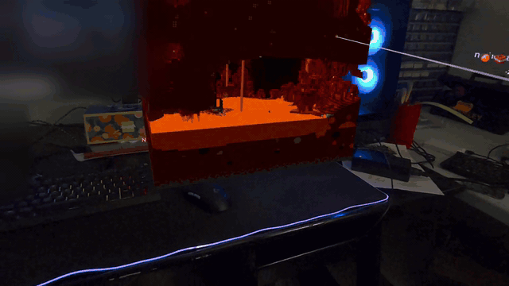
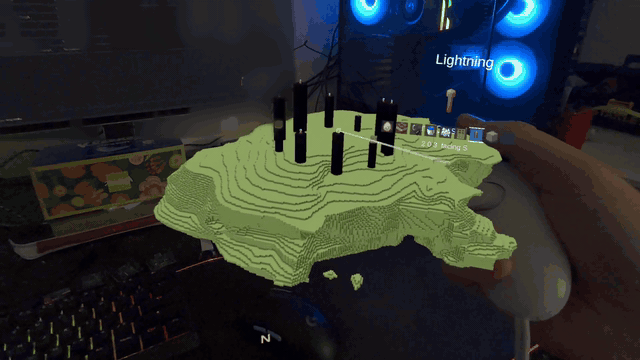
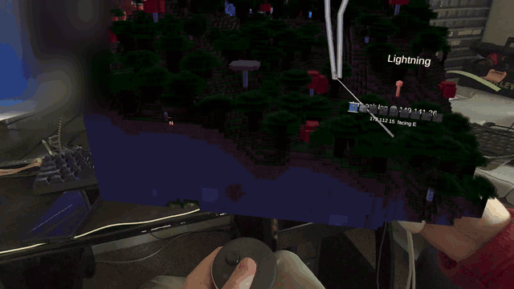
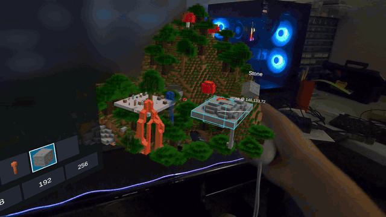
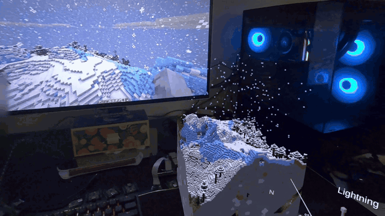
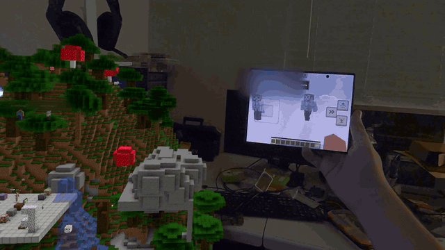

# tabletop-craft-ar

**A live Minecraft: Java Edition server as a miniature on your real table, in Meta Quest 3 passthrough AR.** Build, travel and play god over a world that Java and Bedrock players are walking around in, while they see you as a giant.

> **NOT AN OFFICIAL MINECRAFT PRODUCT. NOT APPROVED BY OR ASSOCIATED WITH MOJANG OR MICROSOFT.**
> The project ships no Mojang assets: textures and sounds come from your own copy of the game.

## What it does

- **A live world on your table.** Any area of a Paper server streams in as a textured, lit miniature you can grab, turn and scale, from a block on the desk to standing in the terrain.
- **Build like a creative player.** Break, place and pick blocks from a block menu and hotbar, and changes from Java players show up live.
- **Use items and mobs.** Open doors, flip levers, pour buckets, use bone meal and spawn eggs, and carry, name or freeze mobs.
- **God powers.** Strike lightning, mark a box and fill it or build walls, sculpt with sphere brushes, and undo any edit.
- **Run the server from the headset.** Chat with players, run console commands and manage players and the world from the operator panel.
- **Travel.** Glide across the world, jump to saved Marks in the Overworld, the Nether and the End, or follow a player.
- **A living world.** Day and night, rain and snow, flowing water and lava, particles, moving mobs and the game's sounds, all on the table.
- **Bedrock friends welcome.** Players on phones, consoles and Windows join through Geyser and show up on the table with their skins.
- **Java players see you as a giant.** Your head and hands float over their world and follow the headset and controllers.
- **Free and open source** under the MIT license.

## See it in action

| | |
|---|---|
|  |  |
| **The Nether on your desk.** Jump to a saved Mark in another dimension and it streams in live. | **The End, pillars and all.** The main island on the table, ready to explore. |
|  |  |
| **Lightning from your hand.** Point the wand and strike: it's real lightning on the server. | **Power tools.** Mark a box with the wand, fill it or build walls, paint with brushes, undo. |
|  |  |
| **Rain and snow.** The server's weather falls on the miniature. | **Bedrock + Java + AR.** A phone player and a Java player in the same live world as the headset. |
|  |  |
| **Building.** Aim with the controller; the triggers place and break blocks. | **The view from Java.** Java players see you as a giant head peering in through their window. |

Recordings are real headset and desktop captures; player names and the room may be visible. More clips and stills: [docs/OVERVIEW.md](docs/OVERVIEW.md#more-recordings).

## Get started

1. On your PC, start **Minecraft: Java Edition 26.3** once in the launcher. The headset uses its textures, models and sounds; nothing from the game ships with this project.
2. Download `tabletop-server-starter-<version>.zip` from the [latest release](https://github.com/NickStassen/tabletop-craft-ar/releases/latest), unpack it and run `start.bat` (Windows) or `bash start.sh` (Linux, macOS). Accept the Minecraft EULA when asked: it fetches Paper and the plugin and starts the server.
3. Get the app on your Meta Quest 3: open the **[beta invite link](https://www.meta.com/s/7Hd4RBdRk)** on your phone or PC, accept it, then install **Tabletop Craft AR** from the headset's Library (no developer mode; the private beta is 18+). Or sideload the release's APK with `adb install`.
4. Start the app at a table. It finds your server on the same Wi-Fi and shows a 6-digit code: type `tabletop pair <code>` in the server window.
5. Wait for the one-time download (about 75 MB), set up the play area on the table, and have friends join with Java Edition at your PC's address.

The full guide is [docs/QUEST_SETUP.md](docs/QUEST_SETUP.md); server commands and options are in [docs/OVERVIEW.md](docs/OVERVIEW.md#quick-start-server).

## Does it work with Bedrock?

Yes, for the players: add [GeyserMC](https://geysermc.org) and Floodgate to the Paper server, and Bedrock players on phones, consoles or Windows join alongside Java players, appear on the table and chat with the headset. The world itself runs on a Java (Paper) server; a Bedrock world can be converted with [Chunker](https://chunker.app). Setup: [QUEST_SETUP Part Q](docs/QUEST_SETUP.md#part-q-bedrock-players-geyser-and-floodgate).

## Learn more

- [Overview](docs/OVERVIEW.md): every feature in detail, what has been verified on a headset, versions, and the server quick start
- [Known issues](docs/KNOWN_ISSUES.md)
- [Headset and server setup](docs/QUEST_SETUP.md)
- [Architecture](docs/ARCHITECTURE.md) · [Protocol](docs/PROTOCOL.md) · [Testing](docs/TESTING.md) · [Plan and roadmap](docs/PLAN.md) · [Research](docs/RESEARCH.md)
- Related: the sister project [ironman-quest3-hud](https://github.com/NickStassen/ironman-quest3-hud) (Unity and Meta XR setup)

## Support

tabletop-craft-ar is free and open source, built in my spare time. If you enjoy it, you can [buy me a coffee on Ko-fi](https://ko-fi.com/nickstassen). It's totally optional, but it really helps keep the project going.

## Legal

**NOT AN OFFICIAL MINECRAFT PRODUCT. NOT APPROVED BY OR ASSOCIATED WITH MOJANG OR MICROSOFT.**

Follow the [Minecraft EULA](https://www.minecraft.net/eula) and [usage guidelines](https://www.minecraft.net/usage-guidelines). Running a server means accepting the EULA yourself; this repo never commits `eula.txt`, the server jar or game assets, and the headset loads textures and sounds only from files you already own.

## License

MIT, see [LICENSE](LICENSE).
